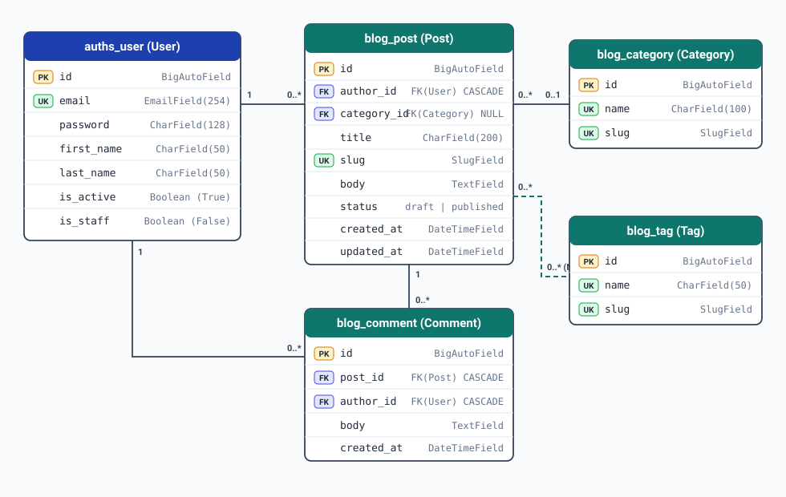

# Blog API

REST API for a blog platform built with Django, Django REST Framework, and Django Unfold.

## Entity-Relationship Diagram (ERD)



## Database Seeding

Populate the database with fake data:

```bash
python manage.py seed
```

Arguments:
- `--users` (default: `20`) — number of users to create
- `--posts` (default: `100`) — number of posts to create
- `--comments` (default: `500`) — number of comments to create
- `--clear` — delete existing data before seeding (keeps superusers)

Example:
```bash
python manage.py seed --users 50 --posts 300 --comments 1500 --clear
```

## Admin Panel Screenshots

### Dashboard


### Post List with Filters


### Post Edit Page


### User List
